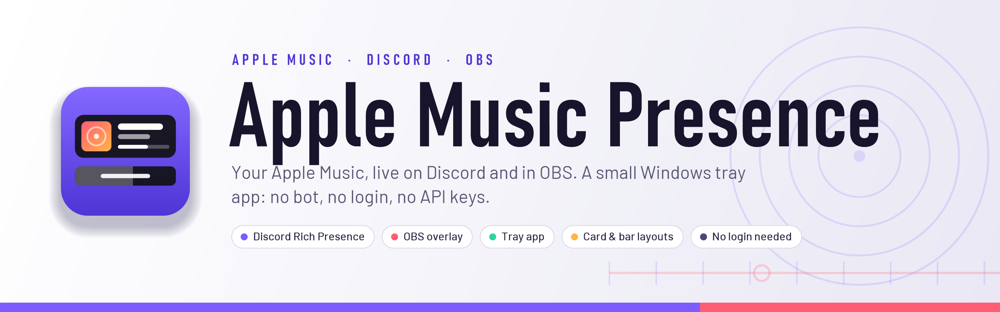
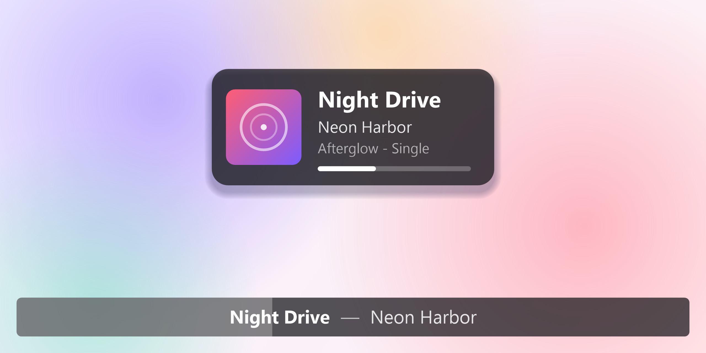
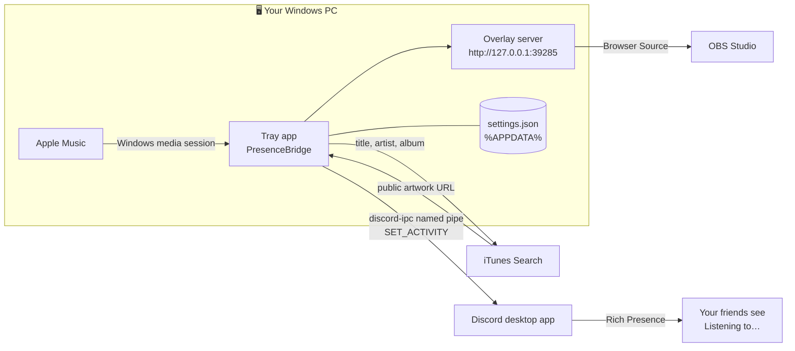
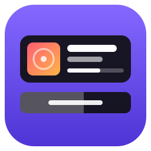

<div align="center">

<picture>
  <source media="(prefers-color-scheme: dark)" srcset="docs/images/banner-dark.png">
  
</picture>

<br><br>


<h3>
  <a href="#-what-it-does">What it does</a> ·
  <a href="#-how-it-works">How it works</a> ·
  <a href="#-get-it-running">Get it running</a> ·
  <a href="#-the-obs-overlay">OBS overlay</a> ·
  <a href="#-whats-in-this-repo">Repo map</a> ·
  <a href="docs/USER_GUIDE.md">User guide</a> ·
  <a href="CHANGELOG.md">Changelog</a>
</h3>

<br>

<picture>
  <source media="(prefers-color-scheme: dark)" srcset="docs/images/hero-dark.png">
  
</picture>

<sub><i>An illustration of the two overlay layouts, drawn from the overlay's own CSS with a made-up song. The real thing shows whatever Apple Music is playing.</i></sub>

</div>

<br>

## 🎧 What it does

Apple Music Presence is a small Windows tray app. It watches the "now playing" media session Windows already keeps (the same one behind the volume-flyout media widget), and shows what Apple Music is playing in two places: your **Discord** profile and an **OBS** overlay.

There's no Apple Music API, no Discord bot and no account login. It only reads what Windows already knows about the current track, and everything it saves lives in one small `settings.json` on your PC.

<table>
  <tr>
    <td width="50%" valign="top">
      <h3>🎧 Discord Rich Presence</h3>
      Shows <b>Listening to…</b> on your profile with the title, the artist, real cover art and a progress bar. Updates settle a few seconds after a track change and wait out Discord's rate limit, so skipping through ten songs doesn't spam your friends. Pausing clears it. If Discord restarts, it reconnects on its own.
    </td>
    <td width="50%" valign="top">
      <h3>📺 OBS overlay</h3>
      A now-playing card for an OBS <b>Browser Source</b>: cover art, title, artist, album and a live progress bar, with the art sliding in and the text sliding out from behind it on every song change. It reads Windows directly, so it's live to the second, with no Discord delays.
    </td>
  </tr>
  <tr>
    <td width="50%" valign="top">
      <h3>📊 Bar layout</h3>
      Add <code>?style=bar</code> for a strip across the whole page: no artwork, just <b>Title — Artist</b> centered on it, and the bar itself fills left to right as the song plays. <code>?progress=off</code> turns the fill off for a plain strip.
    </td>
    <td width="50%" valign="top">
      <h3>🎛️ Everything is a URL tag</h3>
      <code>?scale=</code> resizes it crisply, <code>?fade=</code> hides it after a few seconds, <code>?pos=top|center|bottom</code> places it, <code>?progress=off</code> drops the bar. Tags combine, so the one URL in OBS is the whole setup.
    </td>
  </tr>
  <tr>
    <td width="50%" valign="top">
      <h3>🔔 Recall it on demand</h3>
      With <code>?fade=</code> on, someone asks what's playing? Hit <b>Show song on overlay now</b> in the tray, or call <code>/show</code> from a Stream Deck button, a Streamer.bot <code>!song</code> command or a bookmark. It slides back in, then fades again by itself.
    </td>
    <td width="50%" valign="top">
      <h3>🪟 A proper tray app</h3>
      Right-click the icon for the status window, reconnect buttons, the overlay URLs, <b>Start with Windows</b> and <b>Exit</b> (which clears your presence first). Your Discord Client ID is typed into the status window and saved on this PC, never in the source.
    </td>
  </tr>
  <tr>
    <td width="50%" valign="top">
      <h3>🧹 Tidy metadata</h3>
      Apple Music for Windows sometimes folds a single's album name into the artist field (<code>Artist — Album</code> with a blank album). The app splits it back apart. Cover art is looked up on Apple's public catalog, with a fallback icon when there's no match.
    </td>
    <td width="50%" valign="top">
      <h3>🔒 Private by design</h3>
      The overlay server only answers <code>127.0.0.1</code>. The only call this app makes to the internet is the cover-art search, and it never touches your Apple or Discord login.
    </td>
  </tr>
</table>

<br>

## 🔧 How it works



<details>
<summary><b>The details</b></summary>
<br>

- **Finding Apple Music.** Windows exposes every player's "now playing" state through its media session API (SMTC). The app picks the session whose app ID contains `AppleInc.AppleMusicWin` and listens for title, artist, album, playback and position changes.
- **Discord, over a local pipe.** It talks the `discord-ipc-N` named-pipe protocol straight to your running Discord app: a handshake with your Client ID, then `SET_ACTIVITY` commands. No bot, no OAuth, no tokens. It answers Discord's pings and reconnects within about 5 seconds if Discord restarts.
- **Updates are debounced.** A new track is pushed about **3 s** after it settles. If one was pushed less than **15 s** ago, the next waits out the window, so rapid skipping publishes nothing until you land on a song. Only title, artist or album changes count, so scrubbing doesn't re-push. The constants are `SettleDelay`, `RapidChangeWindow` and `MinSendGap` in `PresenceBridge.cs`.
- **Why cover art is a lookup.** Discord fetches Rich Presence images **from its own servers**, so it can't reach a `127.0.0.1` address or a file on your PC. The app searches Apple's public iTunes catalog for the track and hands Discord that HTTPS URL, falling back to your own `apple_music_logo` asset.
- **The overlay isn't debounced.** `GET /state` reads Apple Music live every time the page asks (once a second), so the progress bar is accurate even while Discord's updates are held back.
- **No background polling.** Re-requesting the media session on a timer isn't free, and it can't fix a stuck Windows broker anyway, so re-attaching is a button (**Reconnect to Apple Music**) instead.
- **One settings file.** The autostart preference and your Discord Client ID live together in `%APPDATA%\AppleMusicDiscordPresence\settings.json`. They're written as a read-modify-write over the whole file, so saving one never clobbers the other.

</details>

<br>

## 🚀 Get it running

```powershell
git clone https://github.com/Ethral-T/apple-music-discord-presence.git
cd apple-music-discord-presence
dotnet build -c Release
dotnet run -c Release
```

You'll need **Windows 10 (1903+) or 11**, the **[.NET 8 SDK](https://dotnet.microsoft.com/download)** to build it, **Apple Music for Windows**, and the **Discord desktop app** for the presence half. It starts in the **system tray**, with no window.

The **OBS overlay works straight away.** Discord needs a one-time setup. Until then the tray says *Overlay only - no Discord Client ID set* and the Discord half stays asleep.

### Discord, one time

1. Go to <https://discord.com/developers/applications> and choose **New Application**. Name it what you want Discord to show after "Listening to" (for example `Apple Music`).
2. Copy the **Application ID** (the Client ID) from the General Information page.
3. Right-click the tray icon, choose **Show status**, paste the ID into the **Discord Client ID** box and press **Save**. It connects right away, with no restart.
4. Optional but recommended: under **Rich Presence → Art Assets**, upload two images named exactly `apple_music_logo` (the fallback large image) and `apple_music_logo_small` (the small corner badge).

> [!TIP]
> Prefer editing the file? Stop the app and put `{"discordClientId": "<your ID>"}` in `%APPDATA%\AppleMusicDiscordPresence\settings.json` (merge it in if it already has `"autoStart"`), then start the app again.

> [!IMPORTANT]
> Discord only shows your presence to other people if **Settings → Activity Privacy → Share your detected activities** is on. If the tray says *Connected* and nothing appears on your profile, check that first.

<br>

## 📺 The OBS overlay

In OBS choose **Sources → + → Browser** and use `http://127.0.0.1:39285/` as the URL. Set the Width and Height to your canvas resolution (Settings → Video) and leave them there. Untick *Shutdown source when not visible* so it keeps updating between scenes. The tray menu can copy the URL for you.

| Tag | What it does |
| :-- | :-- |
| `?style=bar` | The full-width bar instead of the card. |
| `?scale=1.5` | Scales the whole widget, from `0.2` to `6`. |
| `?fade=20` | Hides it once the song has been playing that many seconds. It's back when the next song starts. |
| `?pos=top` · `center` · `bottom` | Vertical placement. The card defaults to center, the bar to the bottom. |
| `?progress=off` | Removes the duration bar (the progress bar on the card, the fill on the bar layout). |

Tags combine, for example `http://127.0.0.1:39285/?style=bar&pos=top&scale=1.2&fade=25`.

> [!TIP]
> **Resize with `?scale=`, not by dragging the source in OBS.** A Browser Source renders at one fixed resolution and OBS stretches that picture to fit however you drag it, which blurs it. The page can't prevent that, but it never has to if the source's size doesn't change and the widget scales itself.

**Recalling it after a fade:** right-click the tray icon and choose **Show song on overlay now (10s)**, or send a plain GET to `http://127.0.0.1:39285/show` (add `?seconds=15` for a different length, 1 to 300). That URL works from a Stream Deck button, a Streamer.bot **Fetch URL** action behind a `!song` command, or a browser bookmark.

<details>
<summary><b>The overlay's JSON, for building your own widget</b></summary>
<br>

The page polls `GET /state` once a second, and so can you:

```json
{
  "isPlaying": true,
  "title": "…", "artist": "…", "album": "…",
  "artUrl": "https://…", "positionMs": 12345, "durationMs": 210000,
  "forceShow": false
}
```

`{ "isPlaying": false }` comes back when nothing is playing. `forceShow` is `true` for a few seconds after `/show` or the tray item.

</details>

<br>

## 📁 What's in this repo

```text
apple-music-discord-presence/
├── Program.cs                        ← WinForms entry point; hands off to the tray app
├── TrayAppContext.cs                 ← the tray icon, its menu, and the app's lifetime
├── StatusForm.cs                     ← the Show status window: Client ID box, status, log
├── PresenceBridge.cs                 ← reads the media session, debounces, drives Discord
├── DiscordIpcClient.cs               ← discord-ipc-N named-pipe client (handshake, SET_ACTIVITY)
├── AlbumArtLookup.cs                 ← cover art as a public HTTPS URL via iTunes Search
├── OverlayServer.cs                  ← local HTTP server: /, /state and /show
├── OverlayPage.cs                    ← the card layout (one self-contained HTML page)
├── BarPage.cs                        ← the full-width bar layout (?style=bar)
├── AutoStart.cs                      ← the Start with Windows registry entry
├── AppSettings.cs                    ← settings.json: autostart and the Discord Client ID
├── AppLog.cs                         ← tiny log the status window subscribes to
├── AppleMusicDiscordPresence.csproj
├── docs/
│   ├── USER_GUIDE.md                 ← the full guide, section by section
│   └── images/                       ← banner, logo and hero art for this page
├── CHANGELOG.md
├── CLAUDE.md                         ← notes for Claude sessions working on this repo
└── LICENSE                           ← PolyForm Noncommercial 1.0.0
```

<details>
<summary><b>What's inside <code>settings.json</code></b></summary>
<br>

It lives at `%APPDATA%\AppleMusicDiscordPresence\settings.json`, outside the repo.

| Key | What it holds |
| :-- | :-- |
| `autoStart` | Whether the app starts with Windows. The tray's **Start with Windows** switch writes it. |
| `discordClientId` | Your Discord application's Client ID. Set it from **Show status**. |

</details>

<br>

## 🎨 Look and feel

<p>
  
  
  
  
  
  
  
</p>

- **The overlay is glass.** A dark card (`#121216` at 72%) with white text, so it reads on top of any scene. The title is bold, the artist a little softer and the album softer still.
- **Fonts:** the system UI font (Segoe UI on Windows), so there's nothing to download inside OBS.
- **Motion with a purpose.** The art slides in from the left and the text slides out from behind it on a new song, and both go away if the system asks for reduced motion.
- **Sizes come from the page, not the source.** Everything scales together from `?scale=`, so it stays sharp at any size.
- **Light and dark art** on this page follow your GitHub theme. Dark is plain black, with no tint.
- **Plain language everywhere.** The tray and status messages say what's happening in ordinary words, like *Connected - nothing playing*.

<br>

## 🛟 When something's off

| Problem | Fix |
| :-- | :-- |
| The tray says *Overlay only - no Discord Client ID set* | Paste your Application ID into **Show status → Discord Client ID** and press **Save**. |
| *Connected*, but nothing shows on your Discord profile | Turn on **Settings → Activity Privacy → Share your detected activities** in Discord. |
| Discord shows the fallback icon instead of the cover | The iTunes search didn't find a match for that track. Upload an `apple_music_logo` art asset so the fallback looks right. |
| The overlay says nothing is playing, but Apple Music is | Press **Reconnect to Apple Music** in **Show status**. If the Win+Z media flyout doesn't show your track either, Windows' media broker is stuck, and restarting Windows fixes it. |
| The widget looks blurry in OBS | Don't drag its corners. Keep the source at your canvas size and use `?scale=`. |
| The widget disappeared after the fade | That's `?fade=`. Use **Show song on overlay now** in the tray, or hit `/show`. |
| The overlay won't start | Port `39285` is probably taken. The log in **Show status** says so, and Discord keeps working. Change the port in `TrayAppContext.cs`. |

More in the [user guide](docs/USER_GUIDE.md#troubleshooting).

<br>

## ⚖️ Trademarks, affiliation and license

> [!NOTE]
> Not affiliated with, endorsed by, or sponsored by Apple Inc. or Discord Inc. "Apple Music" and the Apple Music logo are trademarks of Apple Inc., and "Discord" is a trademark of Discord Inc.

The pictures in `docs/images/` are original illustrations made for this project, and **none of them use Apple's or Discord's logos**. The app doesn't ship any either. Provide your own `AppIcon.ico` (the `.csproj` picks it up if it's there) and your own Discord Rich Presence art assets, and make sure you have the rights to anything you add.

Licensed under the [PolyForm Noncommercial License 1.0.0](LICENSE): free to use, change and share for any **noncommercial** purpose. You may **not** sell it or use it commercially.

<br>

---

<div align="center">
  
  <br>
  <sub>Made for Apple Music on Windows · Not affiliated with Apple or Discord · Built with Claude</sub>
</div>
